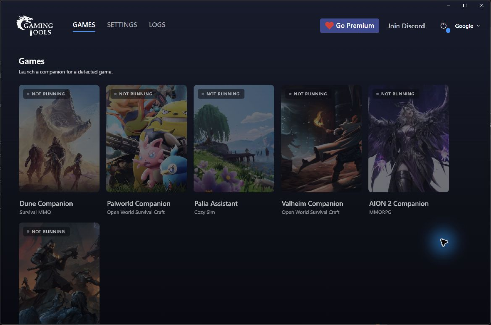
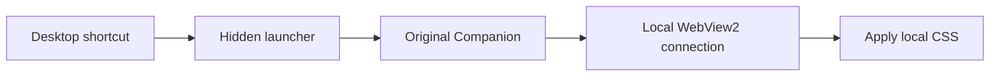

<div align="center">

# gaming.tools Clean Layout

**A quiet Windows launcher that gives Companion its screen space back.**

Hide the advertising sidebar, reclaim its width, and keep wheel scrolling without a visible scrollbar.

<p>
  
  
  
  
</p>

</div>

> [!IMPORTANT]
> **Visual ad hiding, not network ad blocking.** Advertising requests may still occur. This applies local CSS to the main launcher window; it does not unlock Premium, patch the Companion executable, or change your account.



## What changes

| Main launcher | Starting and stopping |
|:--|:--|
| Removes the complete 310 px advertising column, including its reserved space. | Starts the original installed Companion from a separate shortcut. |
| Hides the scrollbar while keeping wheel/touchpad scrolling. | No terminal window needs to stay open. |
| Uses a stable sidebar selector independent of ad-slot children. | The small Node process stays in the background until Companion exits. |

This project follows the minimal approach and documentation style of [TH.GL Clean Layout](https://github.com/Kubuzer/thgl-clean-layout). It targets **gaming.tools Companion**, a different application.

## Quick start

**1.** Install the Windows Companion from [gaming.tools](https://companion.gaming.tools/) and [Node.js](https://nodejs.org/en/download). Node **22+** is required; **24** is recommended. Windows Script Host with VBScript must be available. Nothing is downloaded automatically.

**2.** Download this repository as a ZIP using **Code → Download ZIP**, extract it to a permanent, writable folder, and review the scripts. Keep this folder in place after setup.

**3.** Open **Windows PowerShell** in that folder. Administrator access is **not required**.

```powershell
powershell.exe -NoProfile -ExecutionPolicy Bypass -File .\install.ps1
```

Setup checks the prerequisites, records your local paths, and creates **gaming.tools - Clean Layout** on your desktop. It does not start Companion, install Node, create a scheduled task, or enable Windows scripting.

**4.** Close Companion completely, then use the new desktop shortcut. Continue using that shortcut on later launches. The original shortcut remains available for ordinary, unmodified startup.

> [!TIP]
> **Installed somewhere else?** Pass the exact application path:
>
> ```powershell
> .\install.ps1 -CompanionPath 'D:\Games\gaming.tools\Companion\GT.Launcher.exe'
> ```
>
> If Node is not on PATH, add `-NodePath 'D:\Tools\nodejs\node.exe'`. Paths containing spaces or non-ASCII characters are supported by setup. If you move this folder or reinstall Node, rerun setup. A shortcut from another checkout is preserved rather than overwritten.

## How it works



| File | Purpose |
|:--|:--|
| `companion.css` | The two layout rules; the single source of the visual change. |
| `launch.mjs` | Starts Companion, checks the local WebView2 process, applies CSS, and reapplies after full page loads. |
| `launch-hidden.vbs` | Starts Node without keeping a terminal open. |
| `install.ps1` | Checks paths and creates/removes the separate shortcut and local configuration. |
| `shortcut.ps1` | Uses the Windows Unicode shortcut API so non-ASCII folder names are preserved. |

The WebView2 diagnostic flag is inherited **only by the Companion process started here**. Its random loopback port must belong to a WebView2 child of that exact process. Only the `https://app.gaming.tools` page is selected. No global WebView2 registry policy, DNS setting, certificate, game file, or vendor executable is changed.

The connection is a debugger interface: other programs on the same PC may be able to access it while Companion runs. It is not exposed to the LAN. Close Companion to end that session. No CSS reinjection runs on mouse movement or scrolling.

## Remove or disable

Close Companion, then run from the same folder:

```powershell
powershell.exe -NoProfile -ExecutionPolicy Bypass -File .\install.ps1 -Uninstall
```

This removes this checkout's desktop shortcut and generated path configuration. It preserves Companion, the original shortcut, source files, and the diagnostic log. You can then delete the extracted project folder yourself. For temporary rollback, just launch Companion through its original shortcut.

## Troubleshooting

| Symptom | Action |
|:--|:--|
| Companion is already running | Exit it completely before using the Clean Layout shortcut. |
| Shortcut no longer works | Rerun setup after moving this folder or Node. |
| Windows blocks VBScript | This project does not change your Windows policy. Use it only where Windows Script Host/VBScript is already permitted. |
| CSS cannot attach | Read `launcher.log` beside `launch.mjs`. Check the Companion version and close existing instances before retrying. |
| Ads reappear, layout flickers, or controls are affected | Close Companion and use the original shortcut. Report the version and steps to reproduce. Do not share account files or raw browser-profile data. |

If attachment fails after startup, Companion may remain open without the layout change. Close it before trying again. No automatic mutation retry or process takeover is performed.

## Compatibility and validation

- **Windows only**, with Windows PowerShell 5.1, Windows Script Host/VBScript, and Node.js 22+. No npm dependencies or build step.
- The original local launcher and this **exact CSS** were checked on one PC with Companion **0.5.103** and Node **24.19.0**. The user confirmed scrolling without flicker and no visible scrollbar.
- **This portable package has isolated setup tests; it has not yet been accepted on a second PC or through a full live app session.** The screenshot documents the original accepted local setup, not a claim of wider compatibility.
- Only the main launcher sidebar is covered. Separate game/map windows and overlays are outside this version's tested scope.
- Companion DOM classes, its WebView2 profile location, or diagnostic flags can change. Current profile assumption: `%LOCALAPPDATA%\gaming.tools\Companion\WebView2\EBWebView`.
- The scrollbar thumb is intentionally hidden; wheel/touchpad scrolling remains. An ad may briefly appear before CSS attaches.
- This unofficial community project is not affiliated with gaming.tools, Microsoft, or Node.js. Review the application's applicable terms before use. MIT covers this repository's original code, not vendor assets shown in the screenshot.

## Development

Run on Windows, from the project folder:

```powershell
node --check launch.mjs
node --test tests/install.test.mjs
```

To test using PowerShell 7:

```powershell
$env:CLEAN_LAYOUT_POWERSHELL = 'pwsh.exe'
node --test tests/install.test.mjs
```

Tests use temporary folders and a fake Companion file; they never start the real app or change your desktop. CI repeats the setup checks under Windows PowerShell 5.1 and PowerShell 7. A successful automated run does not prove visual compatibility with a new Companion version.

<sub>License: [MIT](LICENSE). Inspired by [TH.GL Clean Layout](https://github.com/Kubuzer/thgl-clean-layout).</sub>
